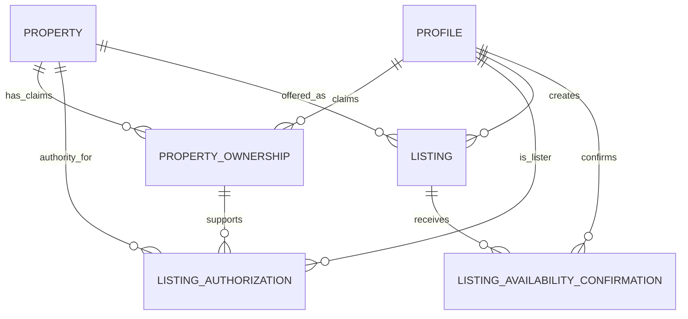

# Dwellora Ownership and Listing Architecture

**Status:** Implemented on stabilization branch; route exposure and database migrations remain gated.
**Scope:** Property ownership claims, listing authority, individual offers, listing lifecycle, availability history and cost disclosure.

## Domain separation

A physical property is not the offer. A single physical property can have multiple rental/sale/short-stay offers over time or for separate units. The architecture separates four records:

1. **Property** — the physical asset/location and durable amenities. This retains the current legacy table and is not itself a marketplace offer.
2. **PropertyOwnership** — a person claims ownership or representative authority over a property. Claims are not automatically trusted; staff verification records reviewer and timestamp.
3. **ListingAuthorization** — a verified owner grants a named lister/agent/property manager authority for this property, with optional start/end dates, evidence category/reference and staff decision.
4. **Listing** — the actual offer. It has a lister, property, offer type, headline, price, billing period, optional unit label, cost fields, availability date, confirmation timestamp, expiry and moderation lifecycle.

Ownership and authorization are intentionally not inferred from the Service provider profile. A user can have multiple capabilities; identity is the user account, not a role enum.

## Entity relationships



## Ownership claim workflow

- Authenticated user submits a claim against a property.
- Evidence category and a private storage reference may be recorded; actual sensitive documents must not be stored in a public URL or the text reference field.
- Duplicate claims by the same profile/property are rejected.
- Claim states: claimed → under review → verified/rejected; verified claims can later be revoked by staff.
- Only staff can review; verified status records the staff reviewer and time.
- Revoking a verified claim revokes its approved authorizations and pauses listings using those authorizations. Direct-owner listings lose publish eligibility.

**Limit:** current implementation represents claims by individual profiles. Legal entities, co-ownership percentages, company registry checks and title-document review require a later extension and specialist workflow.

## Listing authorization

- Owner listers rely on a verified ownership claim for the same property.
- Agent/manager listers request a ListingAuthorization against a verified ownership claim.
- The authorization is bound to one property, one owner claim and one lister account.
- Authority type, evidence category/reference and validity dates are recorded.
- Only staff can approve/reject/revoke the authorization.
- Approval requires verified ownership and staff audit metadata.
- Listing creation cannot assign a different lister or use another agent's authorization.
- Authorization must be current and ownership must remain verified when a listing is submitted or published.

## Listing lifecycle

```
Draft -> Submitted -> Published
                    |-> Rejected -> Draft/edit -> Submitted
Published -> Paused -> (staff re-review/re-publish)
Published -> Rented / Sold / Expired / Removed
```

- Creation assigns lister=request.user server-side. Status, moderation fields and availability-confirmation timestamp are not user-writable.
- Listers may edit/delete only their own draft (rejected listings may be edited and resubmitted).
- Submission requires current verified ownership or approved authority and complete property identity.
- Staff alone publish/reject/remove listings; publishing requires submitted status, valid authority and a recent availability confirmation (30-day freshness window).
- Public listing endpoints return only published listings. Owner workspaces return only that user's listings.
- Availability confirmation is timestamped and append-only. The lister or staff may confirm. A negative confirmation automatically pauses a published offer.
- Confirmation older than 30 days is stale. Stale listings cannot be published until reconfirmed. The public serializer exposes freshness state for a clear label.

## Price and upfront cost

Each Listing records offer type (rent/sale/short stay), amount, currency (GHS default), billing period, rent advance months, deposit, agent fee, viewing fee, service charge and other fees. The current upfront estimate is a convenience calculation based on entered fields; a monthly rent without an advance period has **no estimate** rather than assuming one month. All amounts are validated non-negative.

**Next hardening before consumer UI:** add fee payer (tenant/buyer/lister/shared/unknown), fee frequency, whether each charge is mandatory, and evidence/source. The estimate must not include a charge whose payer or amount is unknown. UI should display each missing item as “Not provided”, never GHS 0. Do not treat listing data as a binding invoice or payment quote.

## Routes (kept separate for now)

Route definitions are in property/listing_urls.py; they are intentionally not mounted in the active URLConf until migration review:

- ownership/claims/ — submit claim
- ownership/my-claims/ — own claims (staff sees all)
- ownership/claims/<id>/review/ — staff review
- authorizations/ and authorizations/my/ — request/list authority
- authorizations/<id>/review/ — staff review
- listings/, listings/<id>/ — published offers
- listings/my/ — authenticated lister's own workspace
- listings/create/, update/delete — own draft operations
- listings/<id>/submit/ — submit for review
- listings/<id>/moderate/ — staff moderation
- listings/<id>/availability/ — lister/staff availability confirmation\n- listings/<id>/charges/ — lister manages structured charges on own draft\n- charges/<id>/update/ and delete/ — own draft cost entries

## Security and validation baseline

- No client-supplied owner/lister identity can override the authenticated account.
- Property and authorization IDs must agree.
- An agent's authorization must be bound to that agent.
- No owner/agent can approve their own ownership or authority; only staff can.
- Listing status and audit fields are read-only in ordinary serializers.
- Public feed excludes draft, submitted, paused, rejected, expired, rented, sold and removed offers.
- Listing update/delete queryset scoping prevents IDOR.
- Sensitive proof documents must use private storage with access control and retention rules; evidence reference is not a document upload endpoint.
- Ownership verification is an administrative evidence check—not a legal title guarantee. UI labels must explain scope.

## Migration and rollout order

1. Inventory current deployed database, schema, records, table collisions and custom-user history. Take a verified backup.
2. Decide how legacy Property records map to physical assets. Do **not** automatically create verified ownership claims from old rows.
3. Generate migrations in a disposable database using the current branch; inspect SQL and dependency order.
4. Test migrations against a copy of the deployed schema/data and verify rollback strategy.
5. Add admin review UI and private evidence storage/retention policy.
6. Mount these endpoints behind tests, staging config and a feature flag.
7. Pilot ownership claims with staff; then authorizations and listing publication.
8. Release consumer discovery only after listing moderation, cost disclosures, availability and report workflow are usable.

No production migration has been generated or applied as part of this architecture work.
